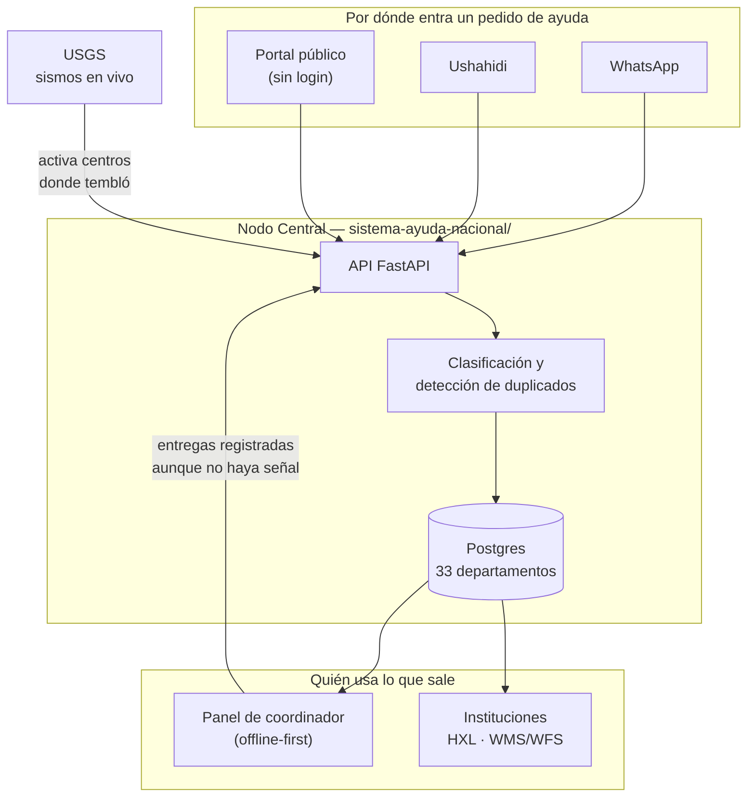

# Ayuda Terremoto Colombia

## 🔗 Demo en vivo

- **Portal público:** https://ayuda-terremoto-portal.onrender.com
- **API / Swagger:** https://ayuda-terremoto-nacional.onrender.com/docs

Alojado en el tier gratis de Render — si nadie lo visita en 15 minutos se
"duerme" y el primer request tarda ~30-50s en despertarlo. Es normal, no es
que esté caído.

Sistema de coordinación de ayuda humanitaria construido tras el terremoto de
magnitud 7.4 con epicentro cerca de San José del Palmar (Chocó) que sacudió
el occidente de Colombia el 10 de agosto de 2026, con afectación oficial en
Chocó, Risaralda, Caldas y Valle del Cauca. Es un evento real: el gobierno
colombiano declaró desastre nacional — ver la cobertura de Chequeado (medio
de verificación de datos): [Terremoto de magnitud 7.4 en Colombia: el Gobierno declara desastre nacional](https://chequeado.com/el-explicador/terremoto-de-magnitud-7-4-en-colombia-el-gobierno-declara-desastre-nacional-y-reporta-al-menos-111-muertos/).

El problema que ataca no es falta de organizaciones ni de dinero para
donar — es **fragmentación de canales**. Cruz Roja, ABACO, Bancos de
Alimentos, la Alcaldía y UNGRD ya operan, pero sin interoperar entre sí. Este
proyecto es una capa de agregación: ingiere reportes ciudadanos y necesidades
de terreno, y los expone en formatos que las instituciones grandes sí pueden
consumir.

**Este proyecto no maneja donaciones ni pagos**, por decisión deliberada de
diseño. Para donar dinero, usa únicamente los canales oficiales ya
establecidos: Cruz Roja Colombiana, ABACO (corredor humanitario), Banco de
Alimentos de Bogotá, o la llave Bre-B publicada directamente por esas
entidades. Ninguna entidad legítima cobra por registrar a alguien como
voluntario, damnificado o para un subsidio — ver la nota de seguridad en
`planoidea.md` §9 sobre estafas activas confirmadas durante esta emergencia.

## Cómo encaja todo



El cuello de botella que ataca el proyecto no es falta de ayuda: es que cada
canal sabe una parte y ninguno sabe el todo. El Nodo Central es la pieza que
junta, y el nodo local es la que sigue funcionando cuando se cae la señal.

## Levantarlo completo en un comando

```bash
cp .env.docker.example .env
docker compose up --build
```

- Nodo Local (PWA): <http://localhost:5173>
- Nodo Central (API): <http://localhost:8000/docs>

Levanta Postgres, el backend y el portal juntos. Para correr cada pieza por
separado (sin Docker), ver el README de cada subproyecto.

## Contenido de este repositorio

- **[`planoidea.md`](planoidea.md)** — el documento de arquitectura completo:
  contexto real de la emergencia, ecosistema de actores existentes, diagrama
  UML, especificación de API, stack recomendado y notas de resiliencia y
  confianza.
- **[`sistema-ayuda-nacional/`](sistema-ayuda-nacional/)** — el Nodo Central
  de la arquitectura nacional: los 33 departamentos de Colombia quedan
  sembrados como centros de coordinación desde el arranque (4 activos con
  datos reales, 29 "dormidos" hasta que un sismo fuerte o un coordinador
  los activa), reportes vía WhatsApp y Ushahidi, colectivos/voluntarios,
  envíos en especie, detección de duplicados, alerta sísmica en tiempo real
  (USGS) con resúmenes por IA (Groq, gratis), export HXL para la comunidad
  humanitaria internacional. Corre sobre Postgres en producción (SQLite
  como fallback local, mismo código para ambos vía `DATABASE_URL`). Ver su
  README para el detalle de qué integraciones son reales y cuáles corren en
  modo sandbox, y para las pruebas de carga/estrés reales contra el backend.
- **[`nodo-local/`](nodo-local/)** — app offline-first (React/Vite +
  IndexedDB), instalable como PWA, con dos caras: un portal público
  (panorama nacional, mapa interactivo accesible por teclado, reportar,
  registrarse como voluntario, todo sin login) y un panel de coordinador
  por centro territorial que sigue funcionando sin conexión y sincroniza
  todo apenas vuelva la señal. Habla con `sistema-ayuda-nacional/`.

## Qué falta (honesto)

**Un número de WhatsApp conectado.** No es algo que falte implementar: el
código del canal está completo —  handshake de verificación de Meta,
validación de firma, parseo del formato real y acuse de recibo opcional. Lo
que pasa es que la cuenta de WhatsApp Business queda a nombre de una
organización concreta, así que **quien despliegue esto conecta su propio
número** con cuatro variables de entorno, sin tocar código. La guía paso a
paso está en
[docs/whatsapp-meta.md](sistema-ayuda-nacional/docs/whatsapp-meta.md).
Mientras tanto el canal corre en modo sandbox y el sistema funciona completo
por web, Ushahidi y carga manual.

**Reverificar contactos antes de un uso real.** Varios centros territoriales
están sembrados con `contacto_verificado = false` justamente porque nadie los
confirmó todavía. El sistema no los muestra como verificados, pero quien
despliegue esto para una emergencia real tiene que completarlos.

Las capas geoespaciales WMS/WFS, que antes estaban en esta lista, ya están
implementadas: ver
[la guía de GeoServer + PostGIS](sistema-ayuda-nacional/docs/geoserver-postgis.md).

## Cómo contribuir

Ver [`CONTRIBUTING.md`](CONTRIBUTING.md) — reglas del proyecto y cómo
correr los tests antes de un PR. Cada subproyecto además tiene su propio
README con instrucciones para levantarlo en local. Si vas a desplegar el
backend para una emergencia real, revisa primero las notas de "próximos
pasos honestos" en su README — hay datos (contactos, canales) que deben
reverificarse antes de mostrarse a nadie más.

## Seguridad

Si encontrás una vulnerabilidad, **no abras un issue público** — ver
[`SECURITY.md`](SECURITY.md), que además documenta qué datos personales
guarda el sistema y qué nunca debe aparecer en un issue, un log o una
captura de pantalla.

## Licencia

MIT — ver [`LICENSE`](LICENSE). Úsalo, adáptalo, despliégalo donde haga
falta.

## Code of Conduct

See [CODE_OF_CONDUCT.md](CODE_OF_CONDUCT.md).
